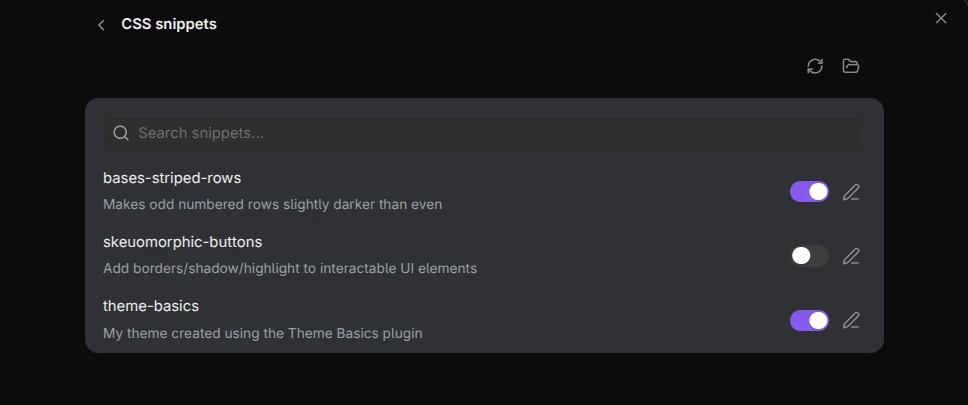

# CSS Snippet Descriptions

A plugin to edit/display CSS snippet descriptions directly within the CSS snippets menu. The description you add is saved within the CSS snippet itself, so even if you're viewing/editing the snippet elsewhere, the description will follow. 

## Screenshots 




## Instructions 

1. In **Settings → Appearance → CSS snippets**, you will notice a new "Edit" button next to the toggle for enabling/disabling a snippet. 
2. Clicking it will bring up a modal with an input field where you can enter a description for the Snippet
3. When you click Save, the description you entered will now be visible underneath the snippet name. Additionally, the description is added to the CSS snippet file itself, like so:

```css
/* @description: Adds alternating row colors. */

.table tr:nth-child(even) {
  background: var(--background-secondary);
}
```

This is where the description is read from, meaning if you edit this CSS files `@description` line outside of Obsidian, the Snippet description shown in the Snippets menu will match. You may need to click "Reload Snippets" to see your changes if modified outside of Obsidian. 

## Install

Available through the Obsidian Community Plugins: https://community.obsidian.md/plugins/css-snippet-descriptions
