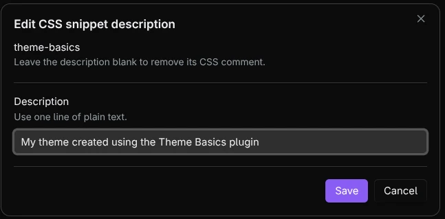

# CSS Snippet Descriptions

A plugin to edit/display CSS snippet descriptions directly within the CSS snippets menu. The description you add is saved within the CSS snippet itself, so even if you're viewing/editing the snippet elsewhere, the description will follow. 

## Screenshots 




## Instructions 

1. On desktop or mobile, go to **Settings → Appearance → CSS snippets**. Look for the pencil button next to a snippet’s toggle.
2. Click or tap the pencil to enter a description.
3. Select **Save**. The description appears beneath the snippet name and is saved in the CSS file itself, like so:

```css
/* @description: Adds alternating row colors. */

.table tr:nth-child(even) {
  background: var(--background-secondary);
}
```

This is where the description is read from, meaning if you edit this CSS files `@description` line outside of Obsidian, the Snippet description shown in the Snippets menu will match. You may need to click "Reload Snippets" to see your changes if modified outside of Obsidian. 

## Install

Available through the Obsidian Community Plugins: https://community.obsidian.md/plugins/css-snippet-descriptions
